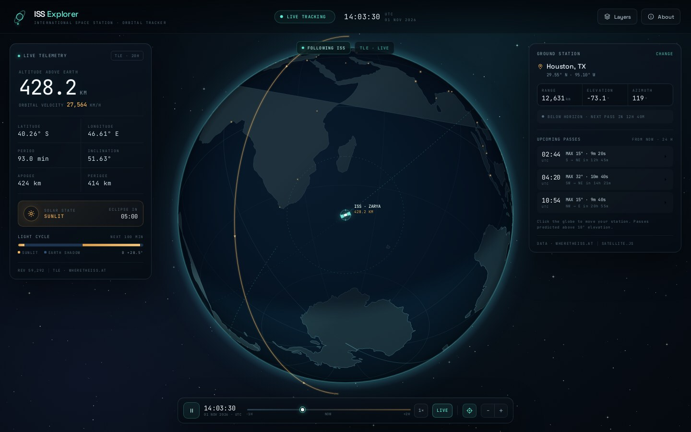

# ISS Explorer

A live, browser-based window onto the International Space Station. ISS Explorer
propagates the station's orbit in real time, renders it on an interactive globe,
and predicts the next passes over your ground station — all without a build
step or framework.



## Highlights

- **Live orbital tracking** — SGP4 propagation via satellite.js, driven by TLE
  elements from [wheretheiss.at](https://wheretheiss.at/), refreshed every three
  hours. Bundled elements keep the app working if the network is unavailable.
- **Interactive orthographic globe** — drag to orbit, scroll or pinch to zoom,
  and click anywhere to move your ground station. The camera can follow the ISS.
- **Day, night and city lights** — a solar terminator, Earth-shadow shading,
  sunlit city clusters, and the station's current illumination state.
- **Orbit and ground tracks** — the orbital ring, recent and upcoming ground
  track, and the ISS visibility footprint.
- **Full telemetry** — altitude, velocity, latitude/longitude, orbital period,
  inclination, apogee/perigee, revolution number, solar beta angle, and the
  next sunrise or eclipse.
- **Pass predictions** — the next 24 hours of passes above 10° elevation from
  your station, with UTC start time, maximum elevation, duration, direction and
  an approximate visibility hint. Click a pass to jump to its peak.
- **Time controls** — pause, scrub ±1/2 hours around now, play at 1×, 60× or
  600×, jump to a predicted pass, or return to live time.
- **Responsive mission-control UI** — optimized for desktop, tablet and phone,
  with keyboard shortcuts, display layers, and shareable URL parameters.

## Run it

No installation or build step is required. A local web server is recommended so
that the live TLE request and geolocation behave consistently:

```bash
cd /path/to/ISS
python3 -m http.server 8000
```

Then open <http://localhost:8000>.

Opening `index.html` directly in a modern browser also works; if the live TLE
request is blocked, the onboard elements are used automatically.

## Controls

| Action | Input |
| --- | --- |
| Orbit the globe | Drag |
| Zoom | Scroll / pinch, or `+` / `−` buttons |
| Set ground station | Click the globe, or **Change** in the Ground Station panel |
| Use current location | **Use my location** in the ground-station dialog |
| Play / pause | `Space` |
| Return to live time | `L` |
| Toggle follow | `F` |
| Reset view | `R` |
| Toggle orbit / track / night / grid | `O` / `T` / `N` / `G` |
| About & shortcuts | `?` |
| Close a dialog or popover | `Escape` |

Pass rows are buttons: selecting one pauses the clock at that pass's peak.

## URL parameters

Useful for sharing a particular view or for automated screenshots:

| Parameter | Meaning |
| --- | --- |
| `offset` | Time offset from now in minutes (`−4320` to `4320`) |
| `lat`, `lon` | Initial ground-station latitude and longitude |
| `name` | Display name for a custom ground station |

Example: [http://localhost:8000/?offset=23&lat=51.5074&lon=-0.1278&name=London](http://localhost:8000/?offset=23&lat=51.5074&lon=-0.1278&name=London)

Supplying `offset` starts the app paused at that forecast/replay time. Without
it, the app begins in live tracking mode.

## How it works

The app loads `vendor/satellite.min.js` and a bundled set of TLE elements, then
propagates the station on every animation frame with SGP4. `js/astro.js` wraps
satellite.js with solar-position, look-angle, pass-prediction and formatting
helpers. `js/globe.js` renders the canvas globe: an orthographic projection,
Natural Earth coastlines clipped at the horizon, a terminator computed from the
solar vector, orbit and ground tracks, and the ISS/observer markers. `js/app.js`
owns application state, the simulation clock, TLE refresh, telemetry and UI
bindings.

Pass predictions are computed from the actual current time over the next 24
hours, not from the simulated clock. This is why the panel is labeled **From
now · 24 h**; jumping to a pass changes the globe's time but leaves the pass
list anchored to the present.

## Project layout

```text
ISS/
├── index.html              Markup, icon sprite, dialogs, time controls
├── preview.jpg             Screenshot used above
├── css/
│   ├── style.css           Layout, top bar, viewport, timebar
│   ├── panels.css          Telemetry, passes, layers popover, modals
│   └── responsive.css      Tablet and phone layouts
├── js/
│   ├── astro.js            Solar math, SGP4 wrappers, passes, formatting
│   ├── globe.js            Canvas orthographic globe renderer
│   └── app.js              State, data refresh, simulation loop, UI
├── data/
│   └── land.js             Natural Earth 1:110m coastline polygons
└── vendor/
    └── satellite.min.js    satellite.js 5.0.0 (MIT)
```

## Notes and limitations

- Positions and passes are approximate. Do not use this app for operational,
  navigation or safety-critical decisions.
- The onboard TLE is a snapshot bundled with the app. When live data is
  available it is replaced automatically; the TLE chip shows the element age.
- Pass predictions use a 10° elevation threshold. The visibility hint is an
  approximation based on the station's sunlight state and the observer's
  darkness.
- The live TLE endpoint is public and may occasionally rate-limit or be
  unavailable; the app falls back silently to the onboard elements.
- Geolocation requires a secure context (`localhost` or HTTPS) and browser
  permission.

## Credits

- [satellite.js](https://github.com/shashwatak/satellite-js) 5.0.0 — MIT
  License.
- TLE data from [wheretheiss.at](https://wheretheiss.at/).
- Coastlines from [Natural Earth](https://www.naturalearthdata.com/) 1:110m
  (public domain).
- Typefaces: Space Grotesk and JetBrains Mono, loaded from Google Fonts when
  online, with system fallbacks.
